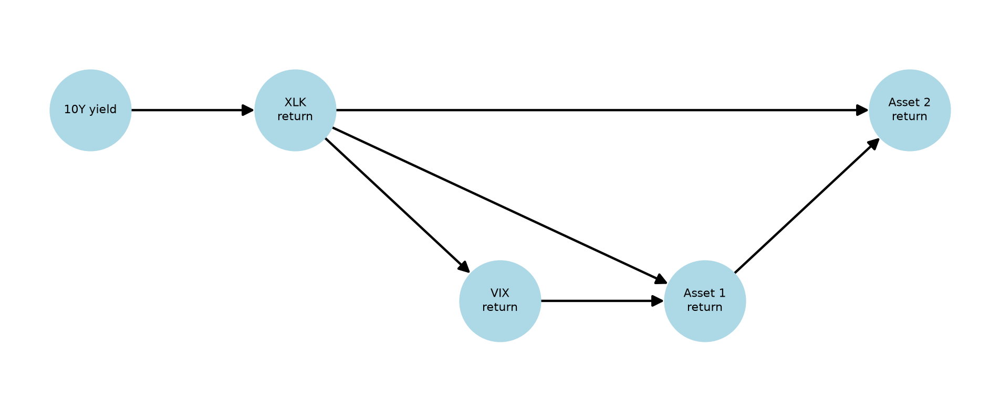

# Data Doctor
### Exploring missing market data with Bayesian networks

**Status: Work in progress**


## Background
The main motivation behind Data Doctor is a personal project exploring whether 
relationships between financial variables can help reconstruct missing market
observations.

I wanted a practical place to experiment with ideas I encountered through
university, independent learning and work experience.

## What it currently does

- Fetches market prices, Treasury yields, options data and news.
- Uses a bounded thread pool to fetch independent datasets concurrently.
- Aligns daily observations and constructs candidate model features.
- Fits a linear-Gaussian Bayesian network using a selected feature subset.
- Estimates hidden asset returns using other observations from the same day.
- Evaluates reconstruction on a chronological holdout against a mean baseline.

The current experiment reconstructs contemporaneous missing returns from past
corrupt data.
## Design and experimentation

The pipeline separates data fetching, DataFrame construction, feature
transformation, model fitting and evaluation.

I initially explored implied volatility and news sentiment alongside
historical market data. The available options snapshot and aggregated
news score did not provide a comparable daily history. I retained them
for exploration but excluded them from the fitted network.

The current network uses:
- Changes in the US 10-year Treasury yield.
- XLK returns.
- VIX percentage changes.
- NVDA and AMD returns.

The graph is hand-specified and represents modelling assumptions,
not proven causal relationships.

## Default Bayesian network

The default Linear Gaussian Bayesian Network models the relationships between
10-year yield changes, XLK returns, VIX returns, and two asset returns.




## Libraries and data sources

| Tool / source | Use |
|---|---|
| [pgmpy](https://pgmpy.org/) | Bayesian-network fitting and inference |
| [pandas](https://pandas.pydata.org/docs/) | Data alignment and feature construction |
| [NumPy](https://numpy.org/doc/) | Numerical calculations |
| [SciPy](https://docs.scipy.org/doc/scipy/) | Distribution calculations |
| [concurrent.futures](https://docs.python.org/3/library/concurrent.futures.html) | Thread-pool execution |
| [yfinance](https://github.com/ranaroussi/yfinance) | Access to Yahoo Finance price and options data |
| [FRED](https://fred.stlouisfed.org/) | US Treasury yield series |
| [Finnhub](https://finnhub.io/docs/api) | Company news |
| [https://vadersentiment.readthedocs.io/en/latest/] | Headline sentiment scoring |

pgmpy provides the parameter-estimation and inference algorithms.
My work focuses on integrating the data sources, constructing the
pipeline, choosing the model structure and designing the evaluation.

## Running the project

1. Create and activate a Python virtual environment.
2. Install dependencies:

   ```bash
   python -m pip install -r requirements.txt
   ```

3. Create a `.env` file in the repository root:

   ```env
   FRED_API_KEY=your_fred_key
   FINNHUB_KEY=your_finnhub_key
    ```


## Results and limitations

Below is an example of a simple test run with the default network:
| Metric | Result |
|---|---:|
| Training rows | 53 |
| Holdout rows | 14 |
| Structure validation | Valid CPD-to-parent mapping |
| Holdout log-likelihood per row | 5.6991 |
| Target | `AMD` (aka asset no.2 in this case) |
| RMSE | 1.2832% |
| Naive-mean RMSE | 3.8740% |
| Direction accuracy | 85.7143% |
| Conditional target volatility | 2.5297% |
| 95% VaR threshold | -4.8585% |
| 95% VaR breaches | 0%|
| 99% VaR threshold | -6.5824% |
| 99% VaR breaches | 0% |


Current results are preliminary. The model assumes linear relationships
and Gaussian noise, and the graph does not explicitly model dependencies
between successive days.

